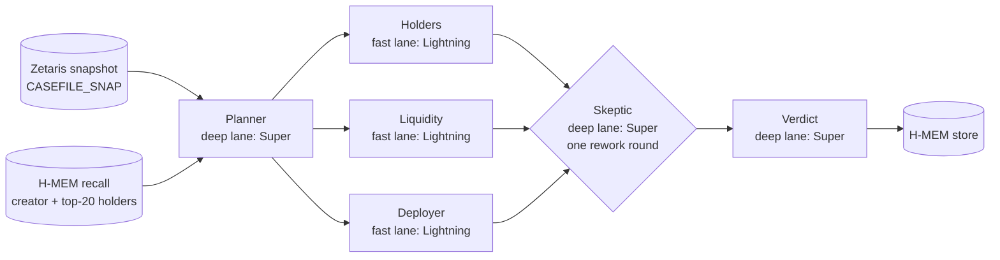

# Casefile

Agents that explain why a Solana token dumped, and show the receipts.

**[Hosted replay](https://casefile-ruddy-two.vercel.app/)** · **[Demo video](https://youtu.be/kUxXoVhABFI)** · **[Slides](https://hackathon-server.genai.works/api/v1/cdn/proxy/hackathon/09d9924ff39442c1a9d2a755456e05af.pdf)**

RugCheck's own `rugged` flag is `false` for ヤギ and kimchisol; Casefile files both as **RUGGED**, and every line of the verdict points to evidence from the frozen data snapshot.
The controls BONK and WIF come back **CAUTION**, not rug.

## Results

The four recorded investigations in `demo_cases/` (open them in the hosted replay):

| Token | RugCheck `rugged` | Casefile | One line (from the verdict) | Duration | Agent calls |
|---|---|---|---|---|---|
| ヤギ | false | **RUGGED** | Insiders control 85.52% of supply, price fell 97.72%, and only about $2.4k liquidity remains with a danger-level low-liquidity risk, indicating a completed rug. | 6 min 20 s | 13 |
| kimchisol | false | **RUGGED** | Price fell 93.54% with only thousands in liquidity and a danger-level low-liquidity risk, indicating a completed rug. | 5 min 21 s | 22 |
| BONK | false | CAUTION | Only weak signal: mutable metadata; ample liquidity, no top-10 insiders, no mint/freeze authority. | 5 min 48 s | 10 |
| WIF | false | CAUTION | No strong rug signals remain; only weak ratio and modest sell-pressure signals are present. | 5 min 20 s | 12 |

Source: `demo_cases/<case_id>/meta.json` and `verdict.json`. "Agent calls" counts every LLM call, including retried ones.

## How it works



- **Open the case.** Zetaris pulls RugCheck and DexScreener through per-token Lightning REST tables, shapes them with views, and freezes them once as Parquet snapshot tables. Agents only ever read the snapshot.
- **Recall.** H-MEM recalls what the desk already knows about the creator and the top-20 holders, including wallets it has marked "likely custodian or exchange".
- **Plan and investigate.** A planner sets 3 to 5 questions; three investigators (holders, liquidity, deployer) answer them in parallel with claims, each citing `table · field · value`. Each citation is checked against the snapshot in code before the Skeptic sees it.
- **Skeptic.** Every claim is accepted or rejected. A rejected claim goes back to its investigator once with a fix request, is reviewed again, and is dropped if it still fails.
- **Verdict.** The verdict uses only accepted claims: RUGGED, HIGH_RISK, CAUTION or NO_RUG_EVIDENCE, with each why-line naming its claim. H-MEM then stores the wallets for future cases.

Every step is written to `runs/<case_id>/<run_id>/trace.jsonl` with its model and Meterless receipt id; the UI replays that trace (schema: `docs/TRACE_SCHEMA.md`).

## Why the Skeptic matters

An early BONK run (`1357f7945f`, older prompts) came out **HIGH_RISK**: a low liquidity/FDV ratio and mutable metadata were treated as strong rug signals. The fix was in the rules, not the token: the Skeptic now rejects "thin liquidity" claims built only on that ratio for an established token with over a million USD of liquidity, and the verdict prompt separates strong signals from weak ones (`casefile/agents/prompts.py`). Every BONK run on the current prompts has come back CAUTION (`docs/RUN_HISTORY.md`).

Across the four demo runs: 30 claims filed, 40 Skeptic decisions, 10 first-round rejections sent back for rework, 9 revised claims accepted, 1 dropped after its rework still failed, 0 left unreviewed.

## Sponsor technology

Details, receipts and tests: `docs/SPONSOR_TECH.md`.

- **Zetaris (data layer).** Per token, `casefile/sources.py` creates Lightning REST tables over DexScreener and RugCheck at runtime and flattens them into SchemaStore views (pairs, summary, holders, risks, insiders, markets, known accounts, lockers). `casefile/snapshot.py` freezes each view with `RUN EXPORT TO STORAGE` into Parquet and registers it as a `CASEFILE_SNAP` filestore table. Agents read only those snapshots: each investigator gets slices of the snapshot tables in its prompt, and can run extra read-only queries through `query_case` (`casefile/agents/tools.py`: SELECT-only, snapshot tables only, all Zetaris calls behind one lock; no demo run needed it).
- **Meterless H-MEM (engine).** `casefile/hmem/` is the H-MEM reference implementation adapted with attribution, plus `casefile.ts` for Casefile's wallet memory. It stores one fact per wallet, case and role (creator, insider, top-20 holder) with token, established flag and verdict, and recalls them at the start of every case. A wallet that is a top holder in two different established tokens gets a derived "likely custodian or exchange" memory, created through H-MEM's dreaming approval step; WIF recalls BONK's shared holders this way. Conformance: 13/13. Live test: `CASEFILE_LIVE_TESTS=1 uv run pytest tests/test_hmem.py`.
- **Meterless Nightshift (AI provider).** `casefile/llm.py` implements the Meterless Power Prompt contract (Runtime 1.4, provider contract v4). Two app ids, `casefile-fast` and `casefile-deep`, are bound in Nightshift to a Lightning lane and a Super lane. Calls stream (SSE) so long answers survive Nightshift's 45 s header deadline, and every call's Meterless receipt is saved to `runs/<case_id>/<run_id>/receipts.jsonl` and shown in the UI.
- **NVIDIA Nemotron.** The three investigators are sent to the fast lane (`casefile-fast`, Nemotron 3.5 Lightning 30B A3B); the planner, the Skeptic and the verdict to the deep lane (`casefile-deep`, Nemotron 3.5 Super VL 120B A12B). Each receipt's `routed_model` records which model actually answered. In the WIF demo run the deployer investigator's claims D1 and D2 were answered by Super: Nightshift ran that call on Lightning, judged the answer divergent, and escalated it to Super (`consensus_escalation` in receipt `rcpt_req_oz1pxls2`). The case board shows the answering model and receipt id on every LLM step.

What was unique:

- **Evidence frozen inside the data platform.** Zetaris fetches, shapes and freezes the evidence (REST tables → views → Parquet snapshots via `RUN EXPORT TO STORAGE`). Every claim cites its evidence as `table · field · value` (a snapshot field, a field computed from the snapshot, or an H-MEM fact), and code checks it before the Skeptic sees it, and the frozen case replays anywhere with no stack.
- **Memory as cross-case wallet reputation.** H-MEM is used to remember wallets across investigations. The derived "likely custodian or exchange" memory is created through H-MEM's dreaming approval boundary, and the Skeptic must respect it, so a known exchange wallet in WIF is not mistaken for an insider because it was already seen in BONK.
- **The receipt is the reasoning trace.** Each role is a separate Nightshift app bound to its own Nemotron lane. Every plan, claim, Skeptic decision and verdict carries the Meterless receipt id and `routed_model` of the call that produced it, so the trace shows which model actually answered, and the UI renders them.

## Honest limitations

- **Slow.** An investigation takes about 5 to 6.5 minutes in the demo runs (319.8 to 380.3 s) and up to about 10 minutes with many aborts (607.5 s, `docs/RUN_HISTORY.md`). Nightshift always sends Nemotron 3.5 with thinking on (no client setting turns it off) and aborts a call that shows no visible token for 45 s (`fixtures/PERF.md`).
- **Retries and fallback.** Steps retry aborted or invalid calls (0, 0, 1 and 8 retries in the four demo runs); a deep step that keeps timing out gets one try on the fast model (no demo run needed it). Some calls are served from Nightshift's cache: 8 of the 50 receipts in the demo runs.
- **Custodians are inferred.** RugCheck `knownAccounts` labels pools, lockers and creators but no exchanges, so exchange wallets are only recognised through H-MEM's cross-case memory.
- **First case open is slow.** Opening a token creates its Zetaris tables, views and snapshots once: 66 s for kimchisol, up to about 5 minutes for BONK's first snapshot build (`fixtures/PERF.md`, `fixtures/SOURCES.md`). Later reads take about a second.
- **`query_case` is available but unused in the demo runs.** The investigators answered from the pre-fetched snapshot slices; no demo run issued an extra SQL query.

## Run it live

The live desk needs a local Zetaris instance with a `DEXSCREENER_REST` Lightning database (`RUGCHECK_REST` and the `CASEFILE_SNAP` snapshot database are created on first use), Meterless Nightshift with the `casefile-fast` and `casefile-deep` apps bound to the Lightning and Super lanes (`fixtures/PERF.md`), and the keys in `.env` (see `.env.example`). Then:

```bash
uv sync && npm install                    # Python deps + tsx for H-MEM
uv run python scripts/check_zetaris.py    # Zetaris up?
uv run python scripts/check_nightshift.py # Nightshift up, roles routed?
uv run python scripts/investigate.py <mint>   # one investigation in the terminal
uv run casefile serve                     # API + UI at http://localhost:8000 (serves web/dist-api)
```

## Run the replay locally (no stack needed)

```bash
uv sync && uv run casefile serve --replay   # API in replay mode + UI at http://localhost:8000
# or the same static build Vercel serves:
cd web && npm ci && npm run build:static && npx vite preview --port 4173
```

## Repo map

| Path | What |
|---|---|
| `casefile/zetaris.py`, `sources.py`, `snapshot.py`, `case_file.py` | Zetaris data layer: REST tables, views, snapshots, one-query case file |
| `casefile/llm.py` | Meterless Nightshift provider, receipts |
| `casefile/agents/` | planner, investigators, Skeptic, verdict, `query_case`, trace |
| `casefile/hmem/`, `casefile/memory.py` | H-MEM engine (TypeScript) and its Python bridge |
| `casefile/server/`, `casefile/trace_schema.py` | FastAPI live + replay API, normalized trace schema |
| `web/` | React UI ported from the Claude Design export (`design/Casefile.html`), `vercel.json` |
| `demo_cases/` | the four exported investigations (trace, verdict, case file, receipts) |
| `fixtures/`, `docs/` | data sources, rug cases, performance, schema, sponsor tech, samples, run history, test results |

## Tests

| Command | Needs | Last result (`docs/TEST_RESULTS.md`) |
|---|---|---|
| `uv run pytest tests -q` | nothing (replay mode) | 21 passed, 1 skipped (the live test) |
| `node scripts/ui_check.mjs` (after `cd web && npm run build:static`) | nothing | UI CHECK PASSED: 64 checks, 0 failures |
| `HMEM_IMPL=$PWD/casefile/hmem/index.ts npx --yes tsx conformance/runner.ts` (in a Meterless checkout, `engines/hmem`) | Node | 13/13 checks passed |
| `CASEFILE_LIVE_TESTS=1 uv run pytest tests/test_hmem.py` | Zetaris + Nightshift | 1 passed in 913.57s (BONK CAUTION, then WIF recalls both shared holders as likely custodian) |

## Pre-existing components

All project code in this repository was written during the build window (22 to 27 October 2026). Third-party components used:

- **Zetaris**: the Zetaris platform (local Docker install) and the `zetaris-getting-started` recipes and AGENTS.md rules, used as guidance; no recipe code is copied here.
- **Meterless**: the Nightshift app (Meterless Runtime 1.4); the Meterless Power Prompt (provider contract v4) and H-MEM prompt as specifications; the H-MEM reference implementation (Apache-2.0), adapted into `casefile/hmem/` with attribution and its `LICENSE`.
- **NVIDIA**: Nemotron 3.5 Lightning 30B A3B and Nemotron 3.5 Super VL 120B A12B, called through Nightshift.
- **Data APIs**: RugCheck (`api.rugcheck.xyz`) and DexScreener (`api.dexscreener.com`), public endpoints.
- **Open-source libraries**: FastAPI, uvicorn, requests, python-dotenv, pytest, httpx (Python); React 18.3.1, react-router-dom, Vite, TypeScript, Playwright, tsx (JavaScript).
- **Design**: the UI design is a Claude Design export (`design/Casefile.html`), unpacked by `scripts/unpack_design.py`; fonts EB Garamond and IBM Plex Mono (SIL Open Font License) come from that export.
